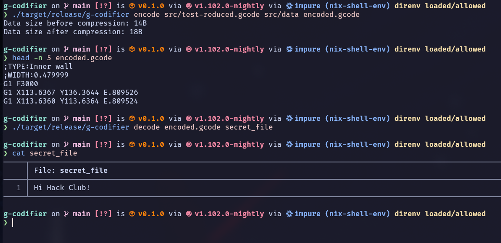

# g-codifier



A little tool for hiding data inside g-code files

## Table of Content

<!--toc:start-->
- [g-codifier](#g-codifier)
  - [Try It](#try-it)
    - [1. Download the Executable from Releases](#1-download-the-executable-from-releases)
    - [2. Use Nix](#2-use-nix)
    - [3. Clone the Repo and Build Locally](#3-clone-the-repo-and-build-locally)
  - [Usage](#usage)
    - [Encode](#encode)
    - [Decode](#decode)
    - [Capacity](#capacity)
  - [Limitations](#limitations)
  - [How It Works](#how-it-works)
  - [What I Learned](#what-i-learned)
  - [AI Disclosure](#ai-disclosure)
<!--toc:end-->
## Try It

### 1. Download the Executable from Releases

Download the current executable for your OS from [GitHub Releases](https://github.com/FraI3mega/g-codifier/releases) and run it in the terminal. 

### 2. Use Nix

```bash
nix run github:FraI3mega/g-codifier -- --help
```

### 3. Clone the Repo and Build Locally

Clone the repo locally and run `cargo run`. You need the nightly toolchain for it.

## Usage

The tool has 3 commands: `encode`, `decode` and `capacity`.

### Encode

```bash
g-codify encode <input-file> <data-to-encode> [output-file]
```

- `input-file` - filename of the g-code file inside of which the data will be hidden
- `data-to-encode` - filename of the file with the data to hide
- `output-file` - defaults to `out.gcode`, sets the processed filename

### Decode

```bash
g-codify decode <input-file> [decoded-data]
```

- `input-file` - filename of the g-code file inside of which the data is hidden
- `decoded-data` - defaults to `decoded-data`, sets the filename of the extracted file
 
Extracts the hidden data from the g-code file

### Capacity

```bash
g-codify capacity <input-file>
```

- `input-file` - filename of the input g-code file

This command counts the maximum capacity for the data **after** compression.
This means you may be able to store a larger file than this if it compresses well

## Limitations

- The max size of the compressed data is about 4GiB, although I'll be in awe if you manage that
- Only supports ASCII g-code
- Tested on g-code output from OrcaSlicer

## How It Works

A G-code file is made up many lines, each containing one command for the machine.

```gcode
G1 X132.731 Y114.611 E.02306
G1 X136.406 Y118.287 E.18947
G1 X135.774 Y118.287 E.02306
G1 X132.731 Y115.244 E.15685
G1 X132.731 Y115.877 E.02306
G1 X135.141 Y118.287 E.12423
G1 X134.508 Y118.287 E.02306
```

By adding an octal digit at the end of each coordinate, we can store some data in it.

```gcode
G1 X132.7313 Y114.6110 E.023063
G1 X136.4063 Y118.2871 E.189474
G1 X135.7742 Y118.2873 E.023062
G1 X132.7312 Y115.2440 E.156852
G1 X132.7311 Y115.8774 E.023063
G1 X135.1412 Y118.2870 E.124232
G1 X134.5080 Y118.2870 E.023060
```

Each row contains 3 digits equating to 9 bits, 8 of which are the data and the last one parity.
Before writing the data, it is compressed to hopefully store more of it in the file.

Since the added digits don't really change the positions too much, it's almost indistiguishable from the original file.

The first 5 changed lines contain the signature - `0xF3`, and the length of the contained data, as a 32 bit unsigned integer.

## What I Learned 

This project made me remember why I love Rust so much.
And the saying about regex definitely holds, it caused some problems, but it wasn't that hard to fix them.
I want to improve the readability of the code, probably refactor the main function. 
I'm also looking into making it a web app, som more people can try it out.

## AI Disclosure

AI has only been used to help with reviewing the code.
It wasn't used for generating any of the code.
